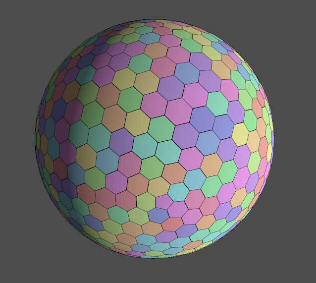
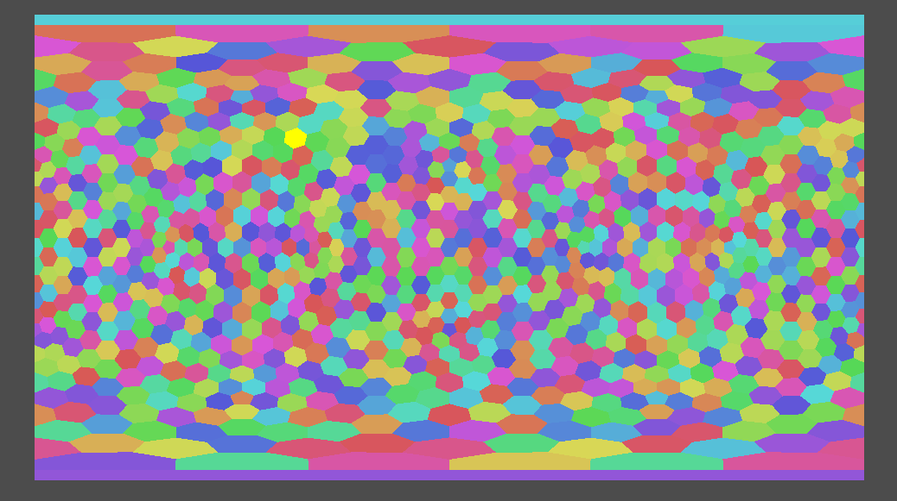
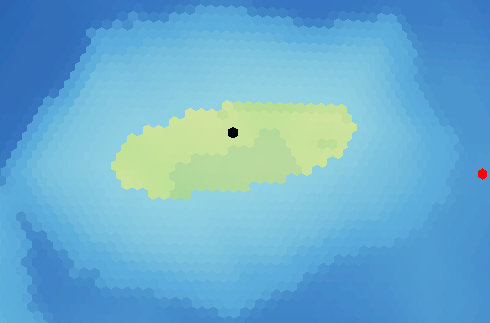
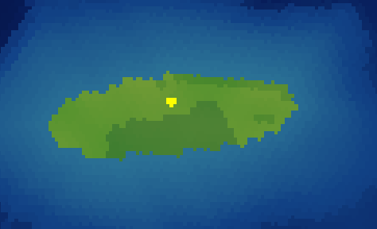

# Hexasphere Generator for Godot 4

Generate spherical grids of hexagons with exactly **12 pentagons**. C++ geometry through GDExtension, with C# nodes usable from C# and GDScript.



- Configurable radius, subdivision, tile gaps and borders.
- Per-tile colors, selection, hover and custom cell data.
- Generation progress, cancellation and restart.
- Mesh uploads and initial visual setup spread across frames.
- Detailed or raster UV maps with pan, zoom and tile picking.

## Installation

Requires **Godot .NET 4.7+**, including for GDScript callers. Tested with **Godot 4.7.2 .NET**, Godot.NET.Sdk 4.7.2, a **.NET 9** target and Windows x86-64.

1. Copy `addons/hexasphere_generator/` into your project.
2. Create/build your project's C# solution.
3. Enable **Hexasphere Generator** in **Project Settings → Plugins**.
4. Add a **Hexasphere** node, adjust its Inspector settings and run. Generation starts automatically.

Windows x86-64 debug/release DLLs are included; keep both with `hexasphere.gdextension`. Linux, macOS and Windows ARM64 require [source builds](#native-build) and are unverified. Exported-game execution has not yet been checked.

## Quick start

Create and generate a sphere from C# inside `_Ready()`:

```csharp
var sphere = new HexasphereNode { AutoGenerate = false, SubDivision = 100 };
sphere.PlanetGenerated += count =>
{
    GD.Print($"Ready: {count} tiles");
    sphere.SetTileColor(0, Colors.Green);
};
sphere.GenerationFailed += error => GD.PrintErr(error);
AddChild(sphere);
sphere.GeneratePlanet();
```

For an existing `Hexasphere` child, disable **AutoGenerate** in the Inspector and use GDScript:

```gdscript
func _ready() -> void:
    var sphere = $Hexasphere
    sphere.PlanetGenerated.connect(func(count):
        print("Ready: ", count)
        sphere.SetTileColor(0, Color.GREEN))
    sphere.GenerationFailed.connect(func(error): push_error(error))
    sphere.GeneratePlanet()
```

Examples: [basic scene](addons/hexasphere_generator/scenes/example/example.tscn) and [solar system](addons/hexasphere_generator/scenes/sol_example/sol_example.tscn).

## Generation and settings

| Setting / method | Purpose |
|---|---|
| `PlanetRadius`, `SubDivision`, `HexSize` | Radius, grid density and tile size; tile count is `10 × SubDivision² + 2` |
| `GenerationSeed` | Reproducible default colors; `-1` uses a random seed |
| `IsBordering`, `BorderColor`, `IsEmissive` | Borders and surface appearance |
| `GeneratePlanet()`, `RestartGeneration()` | Generate using current settings; replace the previous planet |
| `CancelGeneration()` | Cancel the active request |
| `GetGenerationState()`, `IsReady` | NotStarted, Generating, Ready, Failed or Cancelled; interaction requires Ready |
| `GetGenerationStage()`, `GetLastGenerationError()` | Progress stage and failure details |
| `MeshUploadBudgetMilliseconds` | Soft per-node upload/color budget; default 4 ms, `0` uses synchronous setup |
| `MeshUploadTilesPerSurface` | Target cells per mesh surface/color batch; default 8192 |

Settings are captured when generation starts. Wait for `PlanetGenerated` before accessing tiles. Restart, failure, cancellation and node removal release the previous planet and its UV cache. Cancellation discards stale results but cannot interrupt an active native call.

CPU preparation runs on a worker; mesh/texture uploads and custom color hooks use the main thread. Chunking reduces loading stalls at the cost of extra draw calls and possibly longer generation. The budget is not a frame-time guarantee; custom hooks and runtime recoloring can still run synchronously.

Radius must be finite and positive, subdivision **1–1295**, and hex size **0.1–1**. The subdivision limit preserves exact tile IDs in mesh float channels; large valid inputs still require enough memory.

## Tiles and interaction

| Signal | Data |
|---|---|
| `PlanetGenerated` | Tile count; geometry and visuals are ready |
| `GenerationProgressChanged` | Stage, completed stages, total stages |
| `GenerationFailed`, `GenerationCancelled` | Error text for failure; no arguments for cancellation |
| `TileClicked` | Tile index and **world-space** hit position |
| `TileHovered`, `TileDeselected` | Hovered index (`-1` clears hover); no arguments for deselection |

Use `GetTileCount()`, `GetTileCenter(id)`, `GetTilePoints(id)` and `FindTileByDirection(worldDirection)` to query cells. Centers and points are local to the sphere; use `ToGlobal()` for world positions.

`SetTileColor(id, color)` and `SetAllTileColors(colors)` update default `HexCellData` cells and the UV palette. Short arrays leave remaining cells unchanged. For custom data, implement `ICellData` and override `CreateCellData`, `SetVisualController` and the controller's `GetColor`; see the [Earth example](addons/hexasphere_generator/scenes/sol_example/scripts/planets/Earth/Earth.cs).

## UV map



1. Add `scenes/nodes/hexasphere_uv_projector.tscn` from the addon to the same viewport as the sphere.
2. Assign the sphere's `UvProjectorPath` to it.
3. Configure Input Map actions `ui_toggle_uv_map` (for example, **1**) and `ui_close_uv_map` (**Escape**).

Open a ready sphere's map with `sphere.OpenUvProjector()`. `PrepareUvProjector()` builds it without opening. For standalone prepared maps, use `projector.OpenProjection()` / `CloseProjection()`; `IsProjectionOpen` reports view state.

Set `ProjectionMode` to `Auto`, `DetailedMesh` or `Raster`. Auto uses raster above `MaxDetailedTileCount` (default 200,000). Raster quality presets or a custom `RasterResolution` control picking detail; `MapSize` controls displayed size independently. Cells smaller than a raster pixel may be difficult to pick. Initial map builds are synchronous.

The same terrain on the planet surface and in raster UV mode:

| Planet surface | Raster UV map |
|---|---|
|  |  |

Use `RebuildMap()` after settings changes, `GetTileAtUv(uv)` to pick, and `SelectTile(id)` / `ClearSelection()` to change highlights. `UpdateColors(colors)` accepts a complete palette. Recoloring and reopening reuse geometry and raster IDs; call `MarkDirty()` after regenerating the same native instance. Read `GetBuildState()` / `GetLastBuildError()` for build results.

Mouse wheel zooms, right-button drag pans, and left click selects. Custom 3D camera scripts should suspend controls while `HexasphereInputRouter.IsUvProjectionOpenFor(GetViewport())` is true. Shared projectors and camera ownership are coordinated per viewport.

## Native build

Requires Python 3, SCons, a C++17 compiler and the target platform toolchain. From the full repository:

```sh
git submodule update --init --recursive
cd native
python -m SCons platform=windows arch=x86_64 target=template_debug -j4
python -m SCons platform=windows arch=x86_64 target=template_release -j4
```

Outputs go to `addons/hexasphere_generator/bin/`: `hexasphere.windows.template_debug.x86_64.dll` and `hexasphere.windows.template_release.x86_64.dll`. Keep filenames aligned with `hexasphere.gdextension`; variants do not overwrite one another.

For Linux use `platform=linux`; for macOS use `platform=macos`. Mapped architectures are `x86_64` and `arm64`, built separately for each target. Windows ARM64 uses `platform=windows arch=arm64`. Linux outputs `libhexasphere.linux.<target>.<arch>.so`; macOS outputs `libhexasphere.macos.<target>.<arch>.dylib` (no universal binary supplied).

For geometry without scene nodes, use `NativeHexasphere.Generate()` and `BuildMesh()` and dispose the wrapper when finished. Invalid input is rejected, disposal is synchronized, and direct `BuildMesh()` remains synchronous.
